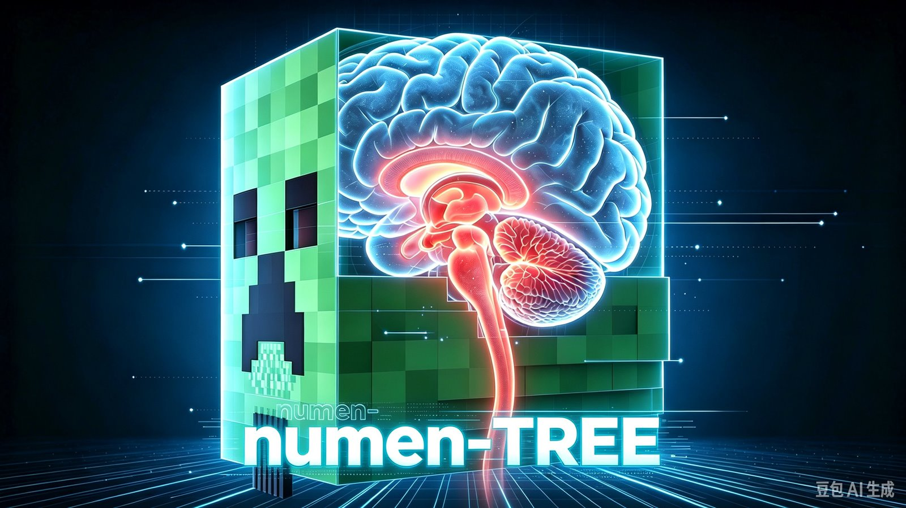
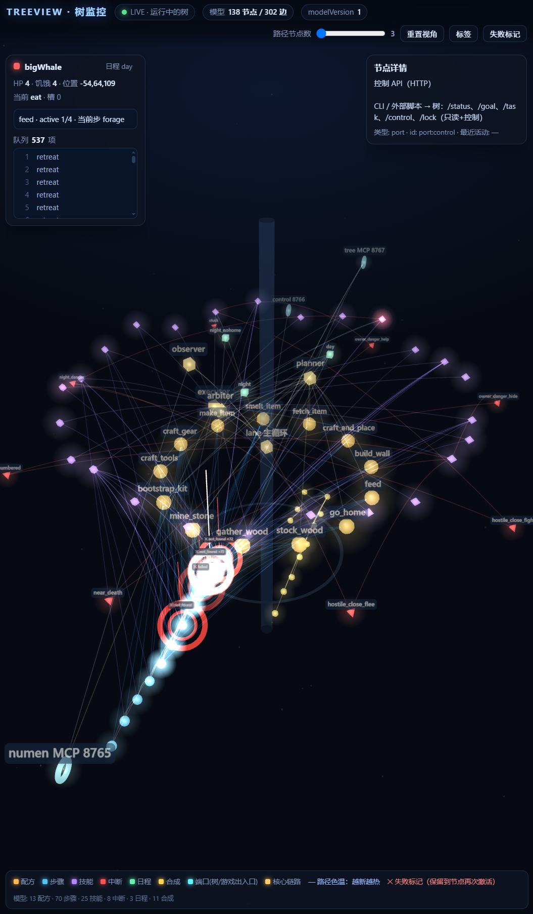

# Numen Tree (numen-tree)

**[简体中文](README.md) | English**

> These instructions were auto-generated by 大肥鲸 and may differ from actual behavior. When in doubt, trust the source code.

A resident "little brain" for numen-driven companions in Minecraft — **you say what to do, you don't puppet them step by step.**

> Unofficial experimental project. Not affiliated with the numen author.

Repository: <https://github.com/moeinside/numen-tree> · License: MIT

---

## 1. What is numen

[numen](https://www.curseforge.com/minecraft/mc-mods/numen-ai) is an **embodied agent that runs inside Minecraft**. It lives in the game as a mod and controls a real player character: it can explore the world, make decisions, and carry out tasks. You can also just talk to it in natural language.

- Author: Dwinovo · open source, free (LGPL-3.0)
- Supports both the OpenAI and Anthropic API protocols, using your own key; any compatible provider works
- Besides its in-game panel, numen can act as an **MCP server driven by an external agent** — that's the "External Brain" channel this project uses

Website <https://numen.dwinovo.cn> · Source <https://github.com/Dwinovo/minecraft-numen>

## 2. The pain: without an LLM, companions cannot move at all

numen gives the companion a body, but **no brain of its own**. With no model attached (no API key, no external agent), a companion is just an empty shell standing still — it won't walk, won't mine, won't find work by itself. You can only watch it idle.

Even with an LLM attached, the classic External Brain setup has the model write Lua step by step: walk two blocks, mine one block, turn around — one model round-trip each. The result is **expensive, slow, and fragile**: when a path is blocked or a target is out of reach (which happens constantly), the model retries the same action over and over while you babysit it.

## 3. What this project does: a "little brain"

numen-tree is a **resident process on your PC** that connects to the in-game numen over a local port and acts as the companion's cerebellum:

- **It doesn't reason, it executes.** The brain (LLM) only talks to the tree — "go chop that patch of oak". The tree turns that into a sequence of actions, watches it run, tries something else on failure.
- **It owns the pacing.** Every step is driven by the tree's rule tables and timers, never waiting on the LLM — so it can't get stuck waiting for a model response.
- **It keeps the companion alive.** Low HP: retreat. Hungry: eat. Surrounded: run. Night: go home. Too far from the owner: walk back. None of this involves the LLM.
- **It reports up.** Done, stuck, or needs a decision — the tree pushes a classified event to the brain. No news, no interruption.
- **It never takes over command.** The LLM can only set goals, not steer walking or swinging; a companion has exactly one driver at a time, so two AIs never fight over one body.

Also included: 25 executable skills (walk, dig, chop, craft, smelt, haul, build, fight, eat, explore, follow…), a places book (home / base / death points), three behavior modes (survival / production / combat, per companion), multi-companion concurrency, and an optional visualization tool.

> ⚠️ **This is an experimental project (WIP).** Interfaces, config and behavior will change. It has only been tested on one save, on Windows, single-player. Don't trust it with a save you care about.

## 4. Prerequisites and installation

### 4.1 What you need

| Dependency | Version / notes |
|---|---|
| Minecraft | **1.21.1** |
| NeoForge | **21.1.265** (minimum 21.1.233), Java 21 |
| numen | **0.1.4.1** — download the NeoForge 1.21.1 build from [CurseForge](https://www.curseforge.com/minecraft/mc-mods/numen-ai) |
| numenlockfix | **1.1.0**, bundled in this repo's [`mods/`](mods/). **Required** — without it companions deadlock after switching saves |
| Node.js | **18+** — install the [LTS build](https://nodejs.org/en/download); `node -v` should print a version |
| DSH | [DeepSeek Harness](https://github.com/deepseek-ai) client, with a working model (DeepSeek account or your own API) |
| DSH config from this repo | [`DSH/dsh-setup.md`](DSH/dsh-setup.md) — one file you hand to DSH and it configures itself |

> You do **not** need an API key inside the numen panel — in External Brain mode the reasoning is billed to the model configured in DSH, not to numen's own key.

> **Version compatibility**: the tree and numen only speak MCP (local HTTP + JSON), so **in theory any Minecraft / NeoForge version where numen can open its External Brain port should work**. Only 1.21.1 + NeoForge 21.1.265 has been verified. To switch versions you mainly change two things: point `tree.config.json`'s `numen.configPath` at your `config/numen/mcp_server.json`, and rebuild the bundled patch jar in `mods/` for that version (source in `patcher/`).

### 4.2 Step by step

1. **Install the mods**: put `numen-neoforge-1.21.1-0.1.4.1.jar` and this repo's `mods/numenlockfix-1.1.0.jar` into the game's mods folder, then **restart the game**.
   (With HMCL version isolation the folder is `.minecraft\versions\<version>\mods\`, not `.minecraft\mods\`.)
2. **Launch the game and enable the External Brain** (this is what makes the connection possible):
   1. Press `G` to open the numen panel (`N` on 1.21.8+);
   2. Go to **Settings → External Brain (MCP)**;
   3. Turn on **"External Brain mode"**;
   4. Confirm **port 8765** (default) and a non-empty **access token**, leave the rest at defaults;
   5. Click **"Save and restart service"** — the status should read "waiting for connection". You do **not** need an API key here;
   6. Summon a companion and give it a name (you'll use that name in goals).

   > You don't need to copy the port or token: the tree reads `config/numen/mcp_server.json` at startup. If you changed the port/token and can't connect, point `tree.config.json`'s `numen.configPath` at that file.

   > Don't confuse this with the DSH preset in step 4: **the in-game switch opens the door; the DSH preset is the brain.** Also skip the panel's "copy onboarding prompt" — that's for connecting an AI directly to numen, not for this project.
3. **Start the tree**: double-click `启动树进程.bat` (or run `node src/daemon.mjs`). Keep the window open — that's the cerebellum.
4. **Configure DSH (just hand the file to the AI)**:
   In DSH, open a **normal session** and give it this repo's [`DSH/dsh-setup.md`](DSH/dsh-setup.md) (attach or paste), then say:
   > "Follow this file and set up the DSH side."

   The AI will find your profile, back it up, write the "External Brain (Numen Tree)" preset, and verify. When it's done it will tell you to restart DSH.
   **Restarting DSH is the one step only you can do** (restarting kills the AI's own session).
5. **Play**: start a new DSH session, choose the **External Brain (Numen Tree)** preset, then just talk:
   > "Have tyrander chop down those trees and come back with a full stack."
6. **Watch**: the companion walks over, works, and reports back; DSH shows what it's doing, and in-game it speaks short lines.

To verify the tree: `node src/cli.mjs status` (where and what it's doing); `node src/cli.mjs lock` (whether the patch is active).

> You can also skip the LLM and send goals from the CLI — see [docs/05-接口契约.md](docs/05-接口契约.md) (Chinese).

### 4.3 What the DSH side needs

- **The DSH client** plus a working model (DeepSeek account, or any OpenAI / Anthropic compatible service)
- **One agent preset** that connects only to the tree (8767), never to numen (8765) — otherwise it fights the tree over the single execution slot per companion

**You don't have to write any of it.** Hand [`DSH/dsh-setup.md`](DSH/dsh-setup.md) to the AI inside DSH: it detects your profile, backs it up, writes the preset and verifies it. The file is **self-contained** (the YAML to write is inside it).

The only step you must do yourself: **restart DSH**. After that, a new session will offer the "External Brain (Numen Tree)" preset.

> Why not the built-in External Brain direct connection? Because it exposes numen's `lua` tool to every session, and multiple sessions driving the same companion deadlock each other. The preset deliberately keeps only the tree channel.

### 4.4 Uninstall

- Delete `mods/numenlockfix-1.1.0.jar` and restart the game → back to stock numen
- Delete the preset block from your DSH config → back to a normal DSH session
- Close the tree window; to clear leftover locks, use `/numenlockfix` in game or `node src/cli.mjs lock --all`

## 5. What it looks like once running

### 5.1 With an LLM (DSH session + tree + game all connected)

- **You only state goals**: "chop this patch", "go home for the night", "store the wood", "follow me and stay close". Pathing, block order, and recovery are handled for you.
- **It keeps itself alive**: eats when hungry, retreats at low HP, goes home at night, walks back when too far; on death it records the spot so you can recover your stuff.
- **It reaches out**: stuck, failed, or needs a decision — it reports; otherwise it stays quiet.
- **It talks**: short lines in game ("done chopping", "that tree is a bit tall"), not data spam.
- **You can interrupt anytime**: change your mind, stop it, reassign — no waiting for the current job to finish.

### 5.2 Without an LLM (only the tree running, DSH closed or offline)

- **The companion doesn't turn into a statue**: the tree keeps it alive by fixed rules — survival, eating, following the owner, executing goals already queued.
- **But it won't understand new requests**: no conversation, no self-directed work; anything outside the rules gets reported and it stops to wait.
- **You can still send goals from the CLI** (`node src/cli.mjs goal …`) — it works, just less natural than with an LLM.
- **With neither** (no tree, no LLM): the companion doesn't move at all — that's the pain point from section 2.

### 5.3 See what it's thinking: tree view monitor

The tree is purely data-driven, so the whole decision tree can be drawn. Double-click **`启动树监控.bat`** — it opens a window and launches `http://127.0.0.1:8780` in your browser:

You can see the current mode, which step the goal is on, which rule branch is active, which step failed, and the companion's live position and path.

It's genuinely useful: when a companion "just stands there", open this and see which step it's stuck on — much faster than reading logs.

It's **read-only** — it never changes the tree or controls companions; with the tree offline it only shows the static structure. Details: [tools/treeview/README.md](tools/treeview/README.md) (Chinese).

## 6. What will go wrong (lower your expectations)

> **This is an experimental project, not a finished mod.** It works, but don't expect production-mod stability.

What it can do today: in a single-player save, make 1–2 companions work through goals, keep themselves alive, and report when stuck.

What you'll actually run into:

- **It gets stuck**: blocked paths, targets behind walls, failed ladder climbing — it stands still or paces back and forth. Rephrase the goal, or open the way yourself.
- **It only knows a few jobs**: within its 25 skills (chop, mine, haul, craft, fight, eat, follow…) it's fine; beyond that it says "I can't" instead of inventing something.
- **Multiple companions aren't smart together**: they don't negotiate — they may fight over the same tree or block each other. Start with one.
- **Say nothing and it idles**: with the LLM offline it only survives by rules, it won't invent new work.
- **Occasional game restarts**: if a companion totally ignores you after switching saves or dimensions, numen's program lock is stuck. The bundled patch clears some cases, not all.
- **No GUI**: state is read from DSH or the CLI; there's no control panel.

When something breaks, check the FAQ in [`DSH/dsh-setup.md`](DSH/dsh-setup.md) and [docs/03-维护手册.md](docs/03-维护手册.md) (Chinese).

## 7. License

- **This project** (tree, patch, docs): [MIT](LICENSE). Use, modify, sell freely; keep the copyright notice.
- **numen**: © **Dwinovo**, [LGPL-3.0](https://www.curseforge.com/minecraft/mc-mods/numen-ai/license). This repo does **not** bundle numen's jar — download it from the official CurseForge page. The description here is a factual summary with a link, not official copy.
- **numenlockfix**: our own standalone patch (MIT). At runtime it clears numen's stale program locks via reflection; it does **not** modify or redistribute numen's code.
- **Minecraft / NeoForge**: © Mojang Studios / NeoForged.
- Not affiliated with the numen author. Report numen-core bugs on [its issue tracker](https://github.com/Dwinovo/minecraft-numen/issues).

## 8. Download safety

- This project is in an early state: **plaintext, unsigned, with no release packages**. All code and config are readable and editable — anyone can change them and publish their own version. There's no hash check or signature telling you whether a file is genuine.
- **The only official source is this repository** (<https://github.com/moeinside/numen-tree>). It is not distributed on any file host, mod site, modpack, or third-party download page.
- Don't trust "one-click installer", "modpack", or "accelerated download" links. If you got a `numenlockfix-*.jar` or script from somewhere else, compare its hash and read it before putting it in your game.
- Never share machine credentials: the **External Brain token** in `config/numen/mcp_server.json` and your **model API key** in DSH. Don't commit them.
- The lock-clearing port (8768) and the tree ports bind to `127.0.0.1` only — **never expose them to the internet**.

---

> The DSH setup guide and all technical docs are currently **Chinese-only** (the AI in DSH can still follow [`DSH/dsh-setup.md`](DSH/dsh-setup.md) as-is). A full English translation can be added on request.
