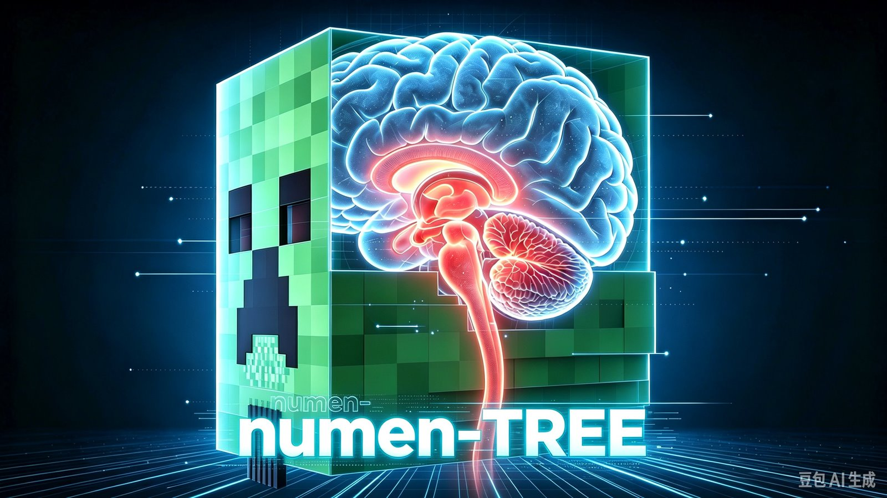
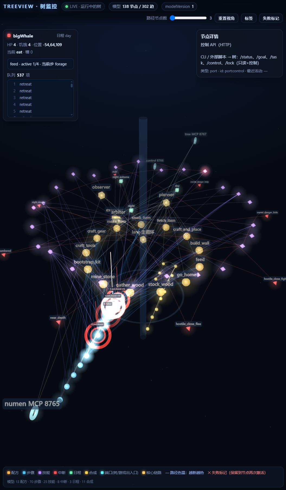

# Numen 脑树（numen-tree）

**[简体中文](README.md) | [English](README.en.md)**

> 以上说明由大肥鲸自动生成，可能与实际行为有出入，一切以源码为准。

给 Minecraft 里由 numen 驱动的同伴配一个常驻的「小脑」：**你只说要做什么，不用一步步指挥它怎么走、先挖哪块。**

> 本项目与 numen 官方无关，是非官方实验项目。

仓库 <https://github.com/moeinside/numen-tree> · MIT 许可证 · 文档全在 [`docs/`](docs/) · 变更记录见 [CHANGELOG](CHANGELOG.md)

---

## 1. numen 是什么

[numen](https://www.curseforge.com/minecraft/mc-mods/numen-ai) 是一个跑在 Minecraft 里的**具身智能体（embodied agent）**：它作为一个 mod 存在，在游戏里控制一个真实的玩家角色，能探索世界、做决定并执行任务，你也可以直接用自然语言跟它说话。

- 作者：Dwinovo · 开源、免费（LGPL-3.0）
- 支持 OpenAI / Anthropic 两种 API 协议，用你自己的 key；任何兼容协议的服务都能填
- 除了自带面板聊天，numen 整体还可以**作为 MCP server 被外部智能体驱动** —— 本项目用的就是这条「外接大脑」通道

官网 <https://numen.dwinovo.cn> · 源码 <https://github.com/Dwinovo/minecraft-numen>

## 2. 痛点：没有 LLM 驱动时，同伴完全不能动

numen 给了同伴身体，但**没给独立的大脑**：不接模型（没 API key、也没接外部智能体）时，同伴就是个站在原地的空壳 —— 不会走、不会挖、不会自己找活干，你只能看着它发呆。

而就算接了 LLM，传统用法是「外接大脑」直接写 Lua 微操：走两步、挖一块、转个身都要往返一次模型。代价是**贵、慢、还容易卡** —— 遇到路被挡、目标够不着这种常态，模型会反复重试同一个动作，你只能在旁边一直盯着催。

## 3. 这个项目做了什么：一个「小脑」

numen-tree 是一个**常驻在你电脑上的独立进程**，通过本地端口连到游戏里的 numen，替你当同伴的「小脑」：

- **它不思考，只执行。** 大脑（LLM）只跟树说话，说「去把那片橡木砍了」；树负责把这句话变成一串动作、盯着执行、失败了换办法。
- **它掌握节拍。** 同伴的每一步由树按固定规则和计时推进，不用等 LLM 回话，天然不会卡在等模型上。
- **它会保命。** 血低了先撤、饿了先吃、被围攻先跑、天黑回家、离主人太远自己往回走 —— 这些不需要 LLM 参与。
- **它会上报。** 干完了、卡住了、遇到需要决策的事，树会把分类清楚的事件推给大脑；没大事就不打扰。
- **它不抢指令权。** LLM 只能「下目标」，不能指挥走路和挥镐；一个同伴同一时间只归一个驱动者，避免两个 AI 打架。

配套还有：27 种可执行技能（走路、挖掘、砍树、合成、熔炼、搬运、建造、战斗、进食、探索、跟随…）、地点簿（家/基地/死亡点）、三种行为模式（生存 / 生产 / 战斗，按同伴独立切换）、多同伴并发，以及可选的可视化工具。

> ⚠️ **这是实验性项目（WIP）**：接口、配置、行为都会变，只在一个存档、Windows + 单机上验证过。别拿它守重要的存档。

## 4. 前置依赖与使用方法

### 4.1 你需要准备

| 依赖 | 版本 / 说明 |
|---|---|
| Minecraft | **1.21.1** |
| NeoForge | **21.1.265**（最低 21.1.233），Java 21 |
| numen | **0.1.4.1**，从 [CurseForge](https://www.curseforge.com/minecraft/mc-mods/numen-ai) 下 NeoForge 1.21.1 版 |
| numenlockfix | **1.2.0**，本仓库 [`mods/`](mods/) 里自带，**必需**（修同伴程序锁残留，否则切存档后会卡死） |
| numen-tree-tentacle | **0.3.0**，本仓库 [`mods/`](mods/) 里自带，**建议装**（只读感知：视野/实体/地标，缺了感知会降级） |
| Node.js | **18 以上**，装 [LTS 版](https://nodejs.org/zh-cn/download)（装完 `node -v` 能出版本号即可） |
| DSH | [DeepSeek Harness](https://github.com/deepseek-ai) 客户端，含一个可用的模型（DeepSeek 账号或自备 API） |
| 本仓库的 DSH 配置 | [`DSH/dsh-setup.md`](DSH/dsh-setup.md) 一个文件，丢给 DSH 就自动配好 |

> **不需要**在 numen 面板里填 API key —— 外接大脑模式下，推理由 DSH 里的模型负责，不消耗 numen 自己的 key。

> **版本适配**：树和 numen 之间只通过 MCP（本地 HTTP + JSON）通信，**理论上只要 numen 能开外接大脑、端口连得上，其他 Minecraft / NeoForge 版本也可以尝试**。本项目只在 1.21.1 + NeoForge 21.1.265 上验证过；换版本时主要改两处：`tree.config.json` 的 `numen.configPath` 指向你的 `config/numen/mcp_server.json`，以及 `mods/` 里的补丁 jar 需按对应版本重新编译（源码在 `patcher/`）。

### 4.2 一步一步来

1. **装 mod**：把 `numen-neoforge-1.21.1-0.1.4.1.jar` 和本仓库的两个 jar（`mods/numenlockfix-1.2.0.jar`、`mods/numen-tree-tentacle-0.3.0.jar`）一起放进游戏的 mods 目录，**重启游戏**。
   （HMCL 开版本隔离时在 `.minecraft\versions\<版本名>\mods\`，不是 `.minecraft\mods\`。）
2. **进游戏，打开「外接大脑」**（这是本项目能连上的前提）：
   1. 按 `G` 打开 numen 面板（1.21.8+ 是 `N`）；
   2. 进 **设置 → 外接大脑 (MCP)**；
   3. 打开 **「外接大脑模式」** 开关；
   4. 确认 **端口 8765**（默认）和 **访问令牌** 有值，其余保持默认；
   5. 点 **「保存并重启服务」**，状态显示「等待接入」就对了。**不需要**在这里填 API key。
   6. 召唤一个同伴并给它起名（后面下目标要用这个名字）。

   > 端口和令牌不用你抄：树启动时会自己读 `config/numen/mcp_server.json`。如果你改过端口/令牌导致连不上，把 `tree.config.json` 里 `numen.configPath` 指向那份文件即可。
   >
   > 别和第 5 步 DSH 里的「外接大脑（Numen 树）」预设搞混：**游戏内这个是开关**（让 numen 把门打开），**DSH 那个是大脑**（负责思考和下命令）。面板里的「复制接入提示词」也**不用**点 —— 那是给 AI 直连 numen 用的，本项目走的是树这条通道。
3. **起树**：双击本仓库的 `启动树进程.bat`（或命令行 `node src/daemon.mjs`）。窗口保持开着，它就是小脑。
4. **配 DSH（把文件丢给 AI 就行）**：
   打开 DSH，新建一个**普通会话**，把本仓库的 [`DSH/dsh-setup.md`](DSH/dsh-setup.md) 整个交给它（附件/粘贴都行），说：
   > 「照这份文件把 DSH 侧配好」

   AI 会自己找到 profile、备份、写入「外接大脑（Numen 树）」预设并自查。它做完会告诉你「请重启 DSH」。
   **重启 DSH 这一步只能你手动做**（AI 一重启就把自己的会话关了）。
5. **开一局**：在 DSH 里新建会话，Agent 预设选「**外接大脑（Numen 树）**」，然后直接说人话：
   > 「让 tyrander 把那边的树砍了，砍满一组就回来」
6. **看效果**：同伴会自己走过去、动手、回来汇报；DSH 界面能看到它在干嘛，游戏里它会用短句说话。

想验证树是否正常：`node src/cli.mjs status`（同伴在哪、在做什么）；`node src/cli.mjs lock`（补丁是否生效）。

> 想跳过 LLM 直接下目标也可以，命令行接口见 [docs/05-接口契约.md](docs/05-接口契约.md)。

### 4.3 DSH 侧需要什么

- **DSH 客户端**本体 + 一个可用模型（DeepSeek 账号，或任意 OpenAI / Anthropic 兼容服务）
- **一个 Agent 预设**：让它只连「树」（8767）、不连 numen（8765）—— 否则会跟树抢同一个同伴的执行槽

**这些不用你手写。** 把 [`DSH/dsh-setup.md`](DSH/dsh-setup.md) 整个交给 DSH 里的 AI 就自动完成：
它会探测你的 profile、先备份、再把预设写进去、最后自查一遍。这份文件是**自包含**的（要写入的 YAML 就在里面，不用另外找）。

唯一必须你亲自做的一步：**重启 DSH**。之后新建会话时，预设列表里会出现「外接大脑（Numen 树）」。

> 为什么不用官方自带的外接大脑直连？因为直连会把 numen 的 `lua` 工具暴露给每个会话，多个会话同时驱动同一个同伴会互相锁死。预设里只留「树」这一条通道，是刻意的设计。

### 4.4 卸载

- 删掉 `mods/numenlockfix-1.2.0.jar` 与 `mods/numen-tree-tentacle-0.3.0.jar` 并重启游戏 → 回到原生 numen
- 删掉 DSH 配置里那段预设 → 回到普通 DSH 会话
- 树进程直接关窗口即可；想清理残留锁，游戏内用 `/numenlockfix` 或 `node src/cli.mjs lock --all`

## 5. 跑起来之后是什么样

### 5.1 有 LLM 驱动（DSH 会话 + 树 + 游戏都通）

- **你只说目标**：「把这片树砍了」「回家过夜」「把木头存起来」「跟着我别乱跑」。怎么走、先挖哪块、卡住怎么办，它自己处理。
- **它会自己活着**：饿了吃、血低先跑、天黑回家、离你太远自己跑回来；死了会把死亡地点记下来，方便下次去捡东西。
- **它会主动找你**：困住了、失败了、需要你拿主意时会报上来；没事时不打扰你。
- **它会说话**：游戏里用短句播报（"砍完了""这棵树有点高"），不是刷屏的数据。
- **你可以随时打断**：改主意、叫停、换任务都行，不用等手上的活干完。

### 5.2 没有 LLM 驱动（只有树在跑，DSH 关着或没网）

- **同伴不会变木桩**：树按固定规则继续让它活着 —— 保命、吃饭、跟着主人、执行队列里已有的目标。
- **但它不会理解新要求**：不能对话，不会自己想新活；遇到规则外的情况只会上报、停手等你。
- **你还能用命令行下目标**（`node src/cli.mjs goal …`），效果有，但不如有 LLM 时自然。
- **什么都没有时**（没树、也没 LLM）：同伴完全不动 —— 这就是第 2 节说的痛点。

### 5.3 看它到底在想什么：树图监控

树是纯数据驱动的，所以整棵决策树能直接画出来看。双击 **`启动树监控.bat`**，会新开一个窗口并自动在浏览器打开 `http://127.0.0.1:8780`：

能看到的：当前模式、目标排到第几步、走的是哪条规则分支、哪一步失败过、同伴的实时位置和路径。

用途很实际：同伴"卡住不动"的时候，先开它看卡在第几步，比翻日志快得多。

它是**只读**工具——不改树、不控制同伴；树没开时只显示静态结构。细节见 [tools/treeview/README.md](tools/treeview/README.md)。

## 6. 会遇到什么麻烦（降低预期）

> **这是实验性项目，不是成品 mod。** 能用，但别指望它像正式发布的同伴 AI 那样稳。

目前能做到的：单机存档里让 1–2 个同伴按目标干活、自己保命吃饭、卡住了上报。

但实际玩起来大致会遇到这些：

- **会卡住**：路被挡、目标在墙后面、爬梯子失败，表现是"站在那不动"或"来回走"。你得换个说法，或者亲自开条路。
- **只会几种活**：27 个技能以内的（砍树、挖矿、搬运、合成、战斗、吃饭、跟随…）能干；超出范围的它会直接说"不会"，不会自己发明办法。
- **多同伴不太聪明**：几个同伴之间不会商量，可能抢同一棵树、堵同一条路。建议先用一个。
- **你不吭声它就发呆**：LLM 不在线时它只会按规则活着，不会自己找新活干。
- **偶尔得重启游戏**：切存档/换维度后同伴要是彻底不听话，多半是 numen 的程序锁卡住了。本项目的补丁会自动清一部分，但没覆盖所有情况。
- **没有图形界面**：看状态靠 DSH 对话或命令行，没有控制面板。

出问题先看 [`DSH/dsh-setup.md`](DSH/dsh-setup.md) 的 FAQ 和 [docs/03-维护手册.md](docs/03-维护手册.md)。

## 7. 版权与许可

- **本项目**（树进程、补丁、文档）：[MIT](LICENSE)。可自由使用、修改、商用，保留版权声明即可。
- **numen**：版权归 **Dwinovo**，[LGPL-3.0](https://www.curseforge.com/minecraft/mc-mods/numen-ai/license)。本仓库**不附带** numen 的 jar，请从 CurseForge 官方页面下载；文中对 numen 的介绍为事实性转述并附链接，非官方文案。
- **numenlockfix**：本项目自写的独立补丁（MIT），运行时通过反射清理 numen 遗留的程序锁，**不修改、不再分发** numen 的代码。
- **Minecraft / NeoForge**：版权归 Mojang Studios / NeoForged 所有。
- 本项目与 numen 作者无隶属关系，遇到 numen 本体的 bug 请去 [其 issue 页](https://github.com/Dwinovo/minecraft-numen/issues) 反馈。

## 8. 下载安全提示

- 本项目目前是**明文、无签名、没有发布包**的早期状态：所有代码和配置都是纯文本，谁都能改一版再发出去，**没有哈希校验也没有签名**告诉你拿到的是不是原版。
- **唯一官方来源就是本仓库**（<https://github.com/moeinside/numen-tree>）。没有发布到任何网盘、mod 站、整合包或第三方下载页。
- 不要轻信"一键安装包""整合包""加速下载"之类的不安全链接。从别处拿到的 `numenlockfix-*.jar` 或脚本，至少先比对文件哈希、看一眼内容再放进游戏。
- 涉及本机安全的东西**不要贴给别人**：`config/numen/mcp_server.json` 里的**外接大脑令牌**、DSH 里配置的**模型 API key**，都是你本机的凭据。
- 补丁的清锁端口（8768）和树的端口都只绑 `127.0.0.1`，**不要把端口暴露到公网**。
